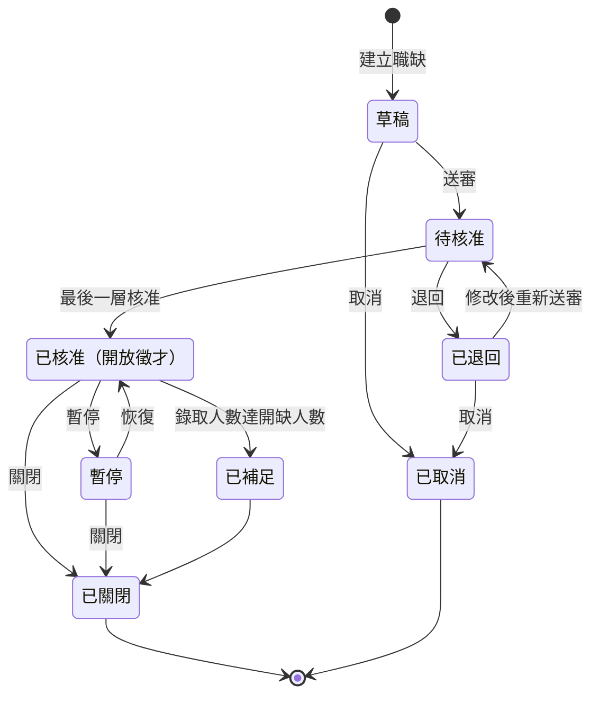

> 示範用合成資料：依職缺管理的一般概念撰寫，不是任何公司的實際系統。
# 狀態圖

職缺（Job Opening）從建立到結束的狀態如下圖；圖下說明各狀態的意思與誰觸發轉移。

## 各狀態的意思

- 「草稿」：招募人員或用人主管建立職缺後、尚未送審的狀態，建立者可修改、送審或取消。
- 「待核准」：已送審、等待核准者審核；這段期間建立者不可修改職缺內容。
- 「已核准」：所有核准層級都已核准，職缺開放徵才，可以接受應徵者。
- 「暫停」：暫時停止徵才，不接受新的應徵者。
- 「已退回」：核准者退回，建立者可依退回原因修改後重新送審。
- 「已補足」：已錄取人數等於開缺人數，不再接受新的應徵者。
- 「已關閉」：職缺結束，不可重新開啟；要再招募須建立新職缺。
- 「已取消」：職缺在核准前就取消，不可重新開啟。

## 誰觸發

- 建立職缺：招募人員或用人主管。
- 送審、取消、修改後重新送審：該職缺的建立者。
- 核准、退回：核准者；第一層是用人主管的直屬主管，開缺人數 6 人以上（含 6 人）再加人資主管做第二層。
- 「暫停」與「恢復」只有招募人員可以執行；用人主管要暫停職缺時，須請招募人員處理。
- 「已核准」改為「已補足」：系統在已錄取人數達到開缺人數時自動變更。
- 關閉「已核准」或「暫停」的職缺：招募人員。
